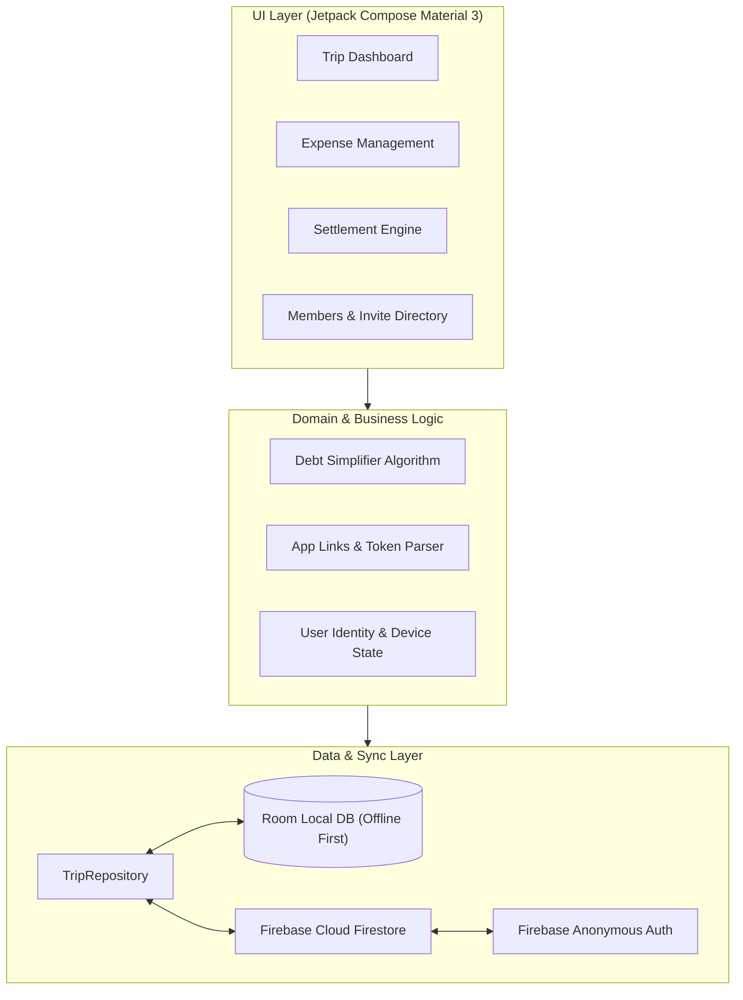

# ✈️ TripSplit

> **Effortless, privacy-first group expense sharing and debt settlement for Android.**  
> Built with **Jetpack Compose**, **Room (Offline-First)**, and **Firebase Cloud Firestore**.

[](https://www.android.com/)
[](https://kotlinlang.org/)
[-4285F4?logo=jetpackcompose&logoColor=white)](https://developer.android.com/jetpack/compose)
[](https://firebase.google.com/)
[](LICENSE)

---

## 🌟 Highlights

* ⚡ **Zero-Friction Joining (No Sign-Up Needed)**  
  No email, password, or phone number required. Friends join an expedition with a single tap using Android App Links from WhatsApp, Telegram, or SMS.
* 🔒 **First-Claim Cloud Lock (Link Burning)**  
  Personalized invite links are claimed on first open in Cloud Firestore. If someone else taps Devang's link later, they are safely blocked (`"This invite has already been claimed by Devang"`), preventing accidental impersonation.
* 🛡️ **Protected Manager Privileges**  
  The trip organizer retains a private administrative recovery key that cannot be demoted or overridden, ensuring full control over trip settings and members.
* 📶 **Offline-First Architecture**  
  Full functionality offline. Add expenses, view balances, and edit details in the middle of nowhere without network access; changes sync seamlessly with Firebase when back online.
* 🧮 **Optimized Debt Simplification**  
  Computes the minimum number of cash transfers required across all participants to settle all debts with mathematical precision.
* 📊 **Visual Analytics & Category Breakdown**  
  Interactive spending charts, category distributions (Food, Stay, Travel, Entertainment), and spending timelines powered by Vico and Compose graphics.
* 🎉 **Polished Motion & Haptics**  
  Rich micro-interactions, smooth page transitions, tactile haptic feedback, Lottie celebrations, and confetti effects upon debt settlement.

---

## 📱 App Walkthrough & Screens

```
Trip Dashboard ────┬───> ➕ Add / Edit Expense (Equal, exact, custom splits)
                   ├───> 👥 Members & Invite Directory (One-tap WhatsApp share)
                   ├───> 💳 Settle Up (Optimized debt minimization)
                   ├───> 📈 Spending Analytics & Category Charts
                   └───> ⚙️ Trip Settings & Manager Controls
```

---

## 🏗️ Architecture & Tech Stack

TripSplit follows modern Android Architecture guidelines with Clean Architecture and a unidirectional data flow (UDF).



### Core Technologies
- **Language**: [Kotlin](https://kotlinlang.org/)
- **UI Framework**: [Jetpack Compose](https://developer.android.com/jetpack/compose) with [Material Design 3](https://m3.material.io/)
- **Persistence**: [Room Database](https://developer.android.com/training/data-storage/room) with [KSP (Kotlin Symbol Processing)](https://kotlinlang.org/docs/ksp-overview.html)
- **Cloud Backend**: [Firebase Firestore](https://firebase.google.com/docs/firestore) & [Firebase Anonymous Authentication](https://firebase.google.com/docs/auth/android/anonymous-auth)
- **Deep Linking**: Android App Links (`https://trip-split-f7805.web.app/join/{token}`) with `android:autoVerify="true"` and hosted `assetlinks.json`
- **Charts & Motion**: [Vico](https://github.com/patrykandpatrick/vico) Compose Charts, [Lottie](https://airbnb.io/lottie/), [Konfetti](https://github.com/DanielMartinus/Konfetti)

---

## 🚀 Getting Started

### Prerequisites
* **Android Studio**: Ladybug / Koala or newer
* **Android SDK**: `compileSdk 36`, `minSdk 24` (Android 7.0+)
* **JDK**: OpenJDK 17 or 21

### 1. Clone the Repository
```bash
git clone https://github.com/vyom027/TripSplit.git
cd TripSplit
```

### 2. Configure Firebase
1. Create a project in the [Firebase Console](https://console.firebase.google.com/).
2. Enable **Firestore Database** and **Anonymous Authentication**.
3. Register an Android App with package name `com.ljku.tripsplit`.
4. Download `google-services.json` and place it in the `app/` directory.

### 3. Build & Install
```bash
# Build Debug APK
./gradlew assembleDebug

# Install directly to connected device
adb install -r app/build/outputs/apk/debug/app-debug.apk
```

---

## 🔗 Android App Links & Deep Linking

TripSplit uses verified App Links to open invite URLs directly in the app without showing the browser disambiguation dialog:

* **Domain**: `https://trip-split-f7805.web.app`
* **Path Pattern**: `/join/{token}` or `/invite/{token}`
* **Verification**: Hosted at `https://trip-split-f7805.web.app/.well-known/assetlinks.json`
* **Custom Scheme Fallback**: `tripsplit://join-trip/{token}`

---

## 🤝 Contributing

Contributions, feature requests, and suggestions are welcome!

1. Fork the Project
2. Create your Feature Branch (`git checkout -b feature/AmazingFeature`)
3. Commit your Changes (`git commit -m 'feat: Add AmazingFeature'`)
4. Push to the Branch (`git push origin feature/AmazingFeature`)
5. Open a Pull Request

---

## 📄 License

Distributed under the MIT License. See `LICENSE` for more information.

